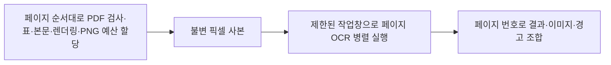

# PDF 병렬 처리와 단계별 시간 검증

이 문서는 공용 배치 예산 도입 전의 기록이다. 최신 구현과 측정·미완료 항목은
[배치·메모리·한국어 검증](../Batch/Batch-Memory-Korean-Verification.md)을 따른다.

2026-10-21. iOS 27.0·Swift 언어 모드 5.0과 기존 의존성을 유지했다.
PDF 전체 페이지 OCR·삽입 이미지 OCR·원본 텍스트·표·PNG 보존을 그대로 수행한다.
본문이 있다는 이유로 OCR을 생략하거나, 해상도를 줄여 얻은 속도 개선이 아니다.

## 구현



- PDFKit·CGPDF·CGContext는 준비 작업에서만 접근한다. PDFKit 썸네일을 실제 소유 픽셀
  버퍼로 복사한 CGImage만 OCR 작업에 전달한다. 이미지 crop도 이 사본을 참조한다.
- Swift TaskGroup으로 자식 작업 수·취소·결과 수집을 관리한다. 동기 Vision 호출이
  Swift 협력 스레드 풀의 진행을 막지 않도록 전용 Dispatch 기반 TaskExecutor에서 실행한다.
  실행 수는 상위 작업창으로 제한하며 임의로 Thread를 계속 생성하지 않는다.
- 작업창 기본값은 활성 CPU 수이고 요청값·CPU 수·페이지 수를 넘지 않는다.
  추정 작업 메모리 목표는 기본 256MiB다. 페이지 크기와 실제 래스터 비용으로 작업창을 좁힌다.
  한 페이지가 목표를 넘으면 단독 처리한다. 이 목표는 Vision 내부·PNG 결과까지 포함한
  프로세스 전체 메모리의 강제 상한은 아니다.
- 배치에서는 문서 동시 작업 수로 PDF 작업창과 작업 메모리를 나눠 중첩 병렬도를 제한한다.
  각 문서에 최소 한 작업은 허용한다. 독립적인 여러 parse 호출을 전역 제한하지는 않는다.
- 이미지 개수·바이트 예산을 준비 단계에서 원본 페이지 순서대로 차감한다.
  OCR이 먼저 끝난 페이지에 예산이 먼저 배정되는 문제를 막는다.
- 문단·표·이미지 블록, 위치·경고를 원본 페이지 순서로 조합한다. 진행률은 완료된 페이지
  개수 기준으로 단조 증가한다. 취소 시 자식에도 전파하지만 동기 Vision 내부 즉시 중단은 보장하지 않는다.
- PDF 결과에 metrics를 추가했다. 공개 API는 [지원 문서](../../../Guides/Document-Parsing-Support.md)의
  PDF 병렬 처리 절을 따른다. 단계별 시간은 문서 내용을 로그에 남기지 않고 수치로 반환한다.
- 기존 HWP 이미지 확장 메서드 3개의 actor 격리를 명시적 nonisolated로 정리했다.
  동기 비 UI 파싱 코드의 MainActor 호출 경고를 제거했으며 언어 모드를 바꾸지 않았다.

## 실기기 성능 비교

iPhone 17, iOS 27.0.1, Xcode 27.1, Debug XCTest. 활성 CPU 6개.
동일한 자체 생성 100페이지 PDF를 작업 수 1·2·4·6으로 각각 3회 처리했다.
반복 순서는 1/2/4/6 → 6/4/2/1 → 2/6/1/4로 섞었다. 모든 측정 전후 thermalState는
0(nominal)이었다. 앱·Vision은 이미 실행된 상태로 cold 성능은 아니다.

[전체 측정 JSON](PDF-Parallel-Stage-Metrics.json).

| 요청 작업 수 | 3회 API 중앙값 초 | 순차 대비 시간 단축 | 프로세스 메모리 표본 최대 MiB | 최대 진행 중 페이지 |
| --- | --- | --- | --- | --- |
| 1 | 7.739 | 기준 | 170.24 | 1 |
| 2 | 6.372 | 17.7% | 161.72 | 2 |
| 4 | 6.356 | 17.9% | 178.72 | 4 |
| 6 | 6.333 | 18.2% | 200.53 | 6 |

6개 작업은 순차 대비 약 **1.22배**, 시간은 **18.2% 단축**됐다.
첫 반복의 OCR 구간을 겹쳐 계산했을 때 동시 OCR 요청도 각각 1/2/4/6개로 확인됐다.
작업 수만 높이고 실제로 순차 실행한 결과가 아니다. 다만 2개 이후 성능 차이는 작다.
3회 표본으로 6개가 모든 문서·기기에서 최적이라고 주장하지 않는다.
현재 기본값은 요청대로 자원 안에서 CPU 수까지 병렬화하며, 메모리를 우선하면
maximumConcurrentPDFPages를 2로 제한할 수 있다.

메모리는 20ms 간격의 프로세스 physical footprint 표본이며 테스트 호스트·프레임워크
캐시를 포함한다. 3회 중 최댓값을 표기했고 결과 해제·캐시 상태 때문에 2개 작업의 값이
1개보다 낮을 수 있다. 다른 실행의 411MiB와 직접 비교해 메모리가 절반 감소했다고 해석하지 않는다.

### 단계별 시간

아래는 각 작업 수의 3회 단계 합계 중앙값이다. 단위는 초.

| 단계 | 순차 | 6개 병렬 |
| --- | --- | --- |
| PDF 열기 | 0.000072 | 0.000072 |
| 연산자·그림 배치 검사 | 0.003985 | 0.003560 |
| 표 분석 | 0.010988 | 0.010383 |
| 원본 텍스트 추출 | 0.001244 | 0.001167 |
| 렌더링·픽셀 소유 사본 | 0.270953 | 0.223903 |
| 그림 crop·PNG 준비 | 0.000205 | 0.000219 |
| 전체 페이지 OCR·중복 검사 | 7.430859 | 36.755695 |
| 결과 조합 | 0.000196 | 0.000177 |
| 부모 완료 대기 | 7.438580 | 6.081723 |

페이지 OCR이 지배적이다. 병렬 OCR의 36.76초는 겹치는 요청 시간을 합한 값으로,
실제 경과 시간 6.33초보다 길다. 부모 대기 역시 OCR과 겹치므로 위 행들을 모두 더해
총 실행 시간으로 쓰면 안 된다. 이 자료만으로 Vision 내부 NPU/GPU 병목을 확정하지 않는다.
100페이지 샘플에는 삽입 그림이 없어 별도 그림 OCR 비용은 없다.

## 혼합 문서의 그림 OCR

[혼합 문서 측정 JSON](PDF-Mixed-Stage-Metrics.json).
원본 텍스트·스캔·혼합 6페이지와 삽입 그림 4개를 1·2·6개 작업으로 각각 처리했다.

| 작업 수 | 실제 PDF 경과 초 | 그림 OCR 합계 초 | 전체 페이지 OCR 합계 초 |
| --- | --- | --- | --- |
| 1 | 0.962 | 0.294 | 0.639 |
| 2 | 0.616 | 0.383 | 0.746 |
| 6 | 0.588 | 0.766 | 1.357 |

순차와 병렬의 본문·블록·PNG 이미지·위치·경고가 일치하는 별도 검사를 통과했다.
위 혼합 시간은 각 1회이며 정밀한 성능 우열·일반 OCR 정확도의 보장은 아니다.

## 검증 및 시행착오

- 일반·스캔·혼합 PDF의 순차/병렬 결과 동등성.
- 이미지 최대 1개/128개에서도 원본 순서에 따른 이미지 보존·경고 동등성.
- 작업 메모리 목표 1바이트에서는 페이지를 생략하지 않고 단독 처리함을 확인.
- 병렬 작업 중 취소 전파·완료 이벤트 부재·진행률 단조 증가.
- 혼합 배치의 입력 순서와 문서별 PDF 작업창 분배.
- 기존 회전·중첩 Form·클리핑·병합/무선 표·다중 TIFF·한영 OCR·위험 입력 회귀 검사.

최초 실기기 병렬 시험은 진행이 정체돼 소유한 테스트 실행을 중단했다.
Time Profiler를 5초 부착해 대부분 유휴인 상태를 확인했지만 정확한 내부 잠금 위치까지
확정하지는 못했다. PDFKit 데이터 공급자와 연결될 수 있는 썸네일을 실제 픽셀 사본으로
분리하고, 동기 OCR을 전용 TaskExecutor로 옮긴 뒤 12회 비교와 전체 회귀에서 재현되지 않았다.
이를 특정 프레임워크 내부 교착의 확정 진단으로 보고하지 않는다.

- 비교 시험 및 동등성 5개: `/tmp/issue21-pdf-parallel-device2.xcresult`.
- 최초 중단 실행: `/tmp/issue21-pdf-parallel-device.xcresult`.
- 추적: `/tmp/issue21-pdf-parallel-live.trace` (성능 표의 측정에 사용하지 않음).
- 전체 회귀와 기존 100페이지 성능 시험: `/tmp/issue21-pdf-parallel-final-device.xcresult`.
- 혼합 시간 시험: `/tmp/issue21-pdf-mixed-timing.xcresult`.

## 재현 명령

실기기 서명 팀은 명령행에서만 전달하며 저장소 설정에 반영하지 않는다.

```sh
xcodebuild test -project Researchers.xcodeproj -scheme Researchers \
  -destination "platform=iOS,id=$DEVICE_UDID" -parallel-testing-enabled NO \
  -only-testing:ResearchersTests/DocumentPDFParallelPerformanceTests \
  -collect-test-diagnostics never -resultBundlePath /tmp/PDFParallelTiming-새경로.xcresult \
  DEVELOPMENT_TEAM="$DEVICE_TEAM_ID" CODE_SIGN_STYLE=Automatic
```

전체 회귀에서는 비교 시험만 제외했다. 비교 자체는 위 별도 실행에서 검증했다.
시뮬레이터 회귀에서는 이미 실기기에서 처리한 두 100페이지 반복 시험을 제외한다.

```sh
xcodebuild test -project Researchers.xcodeproj -scheme Researchers \
  -destination 'platform=iOS Simulator,id=46BECA1F-89C4-42E2-B9DD-5F6CB316E62B' \
  -parallel-testing-enabled NO -collect-test-diagnostics never \
  -skip-testing:ResearchersTests/DocumentPerformanceTests/testHundredPagePDFReportsTimeAndSampledFootprint \
  -skip-testing:ResearchersTests/DocumentPDFParallelPerformanceTests/testCompareSerialAndParallelStageTimesOnHundredPages \
  -resultBundlePath /tmp/PDFParallelRegression-새경로.xcresult
xcodebuild build -project Researchers.xcodeproj -scheme Researchers \
  -destination 'generic/platform=iOS Simulator'
swiftlint lint --strict
```

## 최종 실행 결과

- 실기기 회귀 **92개 통과, 실패 0건**, 44.830초. 기존 100페이지 반복 시험도 포함했다.
  비교 측정 클래스는 별도 실행으로 분리했다.
- 별도 100페이지 비교 1개·혼합 문서 측정 1개도 통과했다. 현재 94개 메서드가 모두
  실기기에서 검증됐으며 동일한 한 실행에서 94개가 통과했다고 표현하지 않는다.
- 시뮬레이터 **92개 통과, 실패 0건**, 88.923초. 두 100페이지 반복 시험만 제외했고
  혼합 문서 측정은 포함했다.
- CI 앱 빌드 성공. strict lint **84개 파일·위반 0건**.
- 공개 원본 60개 해시·수량 및 `git diff --check` 통과.
- 프로젝트·scheme·Package.resolved의 작업 전후 SHA-256 동일. 서명 설정·OS 최소
  버전·Swift 언어 모드·SPM 의존성 변경 없음. 커밋·푸시는 수행하지 않았다.

로그: `/tmp/issue21-pdf-parallel-final-device.log`,
`/tmp/issue21-pdf-parallel-final-simulator.log`, `/tmp/issue21-pdf-parallel-build.log`,
`/tmp/issue21-pdf-parallel-final-lint.log`.

시뮬레이터 xcresult: `/tmp/issue21-pdf-parallel-final-simulator.xcresult`.
서명 설정 검증: `/tmp/issue21-pdf-parallel-settings-before.sha256`,
`/tmp/issue21-pdf-parallel-settings-after.sha256`.

단일 기기·짧은 반복·고정 샘플 결과다. 실제 대용량 스캔 문서·장시간 발열·배터리·
최소 메모리 기기·독립 parse 다중 호출에 대한 전역 자원 제한은 별도 검증/설계 범위다.

## 실제 대용량 입력의 후속 검증

위 표의 자체 생성 문서와 구분하여 실제 USGS 스캔 원본 204쪽 및 혼합 배치를 검증했다.
결과·권리·원본 해시·실행 명령은 [대용량 검증](../Batch/Large-Scan-Batch-Verification.md)을 따른다.
