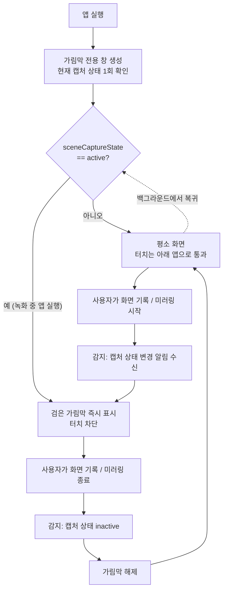
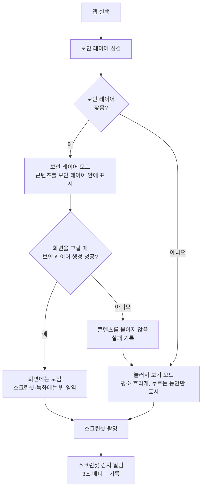

# 화면 캡처 및 녹화 차단 기술검증

> 담당: @wondrone0113 · 관련 이슈: #24

## 1. 개요

연구 데이터(녹음 타임라인 등)가 스크린샷이나 화면 녹화로 앱 밖에 새어 나가지 않게 막을 수 있는지 검증했다.

검증한 내용은 세 가지다.

- **스크린샷 마스킹**: 스크린샷을 찍으면 민감한 영역이 빈 화면으로 찍히는가
- **화면 기록·미러링 감지**: 화면 기록이나 AirPlay 미러링이 시작되는 순간을 알아채고 화면을 가리는가
- **녹화 중 앱 실행**: 이미 녹화가 켜진 상태에서 앱을 열어도 처음부터 가려지는가

iOS는 스크린샷 자체를 막는 공식 API를 제공하지 않는다. 그래서 "찍히더라도 내용이 비어 보이게" 만드는 방식과 "찍혔다는 사실을 감지"하는 방식을 함께 쓴다.

## 2. 구현 방법

### 2-1. 스크린샷 마스킹 — 보안 레이어 방식

iPhone에서 비밀번호 입력칸에 글자를 넣고 스크린샷을 찍으면, 입력한 글자는 사진에 나오지 않는다. iOS가 비밀번호 칸의 내용을 그리는 레이어(보안 레이어)에 "화면 캡처에서 빼라"는 표시를 붙여 두기 때문이다.

이 방식은 그 보안 레이어를 빌려 쓰는 것이다.

1. 화면에 보이지 않는 비밀번호 입력칸(`UITextField`, `isSecureTextEntry = true`)을 하나 만든다.
2. 그 안에서 보안 레이어를 가진 내부 뷰를 찾아 떼어 낸다.
3. 떼어 낸 뷰를 그릇으로 삼아 연구 데이터 화면을 그 안에 넣는다.

결과적으로 **사용자 눈에는 평소처럼 보이지만, 스크린샷·화면 녹화 결과물에서는 그 영역만 비어 보인다.**

이 보안 레이어는 Apple이 공개한 기능이 아니다. iOS 버전에 따라 찾지 못할 수 있으므로, 앱 시작 시 보안 레이어를 쓸 수 있는지 먼저 점검한다. 쓸 수 없으면 **"눌러서 보기"** 모드로 바꾼다. 내용을 평소에는 흐리게 가려 두고, 손가락으로 누르고 있는 동안에만 보여 준다.

### 2-2. 화면 기록·미러링 감지

iOS는 앱 화면이 지금 녹화되거나 다른 화면으로 미러링되고 있는지를 앱에 알려 준다(`sceneCaptureState`). 이 값은 공식 API다.

- 값이 `active`로 바뀌면 → 앱 전체를 덮는 **검은 가림막**을 즉시 띄우고 터치도 막는다.
- 값이 다시 `inactive`가 되면 → 가림막을 걷는다.
- 앱이 백그라운드에 있는 동안 녹화가 시작·종료됐을 수 있으므로, 앱으로 돌아올 때마다 다시 확인한다.

가림막은 시트나 알림창 위까지 덮어야 하므로 앱 화면과 별도의 최상위 창(`UIWindow`, `windowLevel = .alert + 1`)에 그린다.

### 2-3. 스크린샷 감지

스크린샷은 찍힌 **뒤에야** 알림(`userDidTakeScreenshotNotification`)이 온다. 막을 수는 없으므로 "스크린샷이 감지됐어요" 배너를 3초간 띄우고, 마지막 감지 기록을 남기는 데 쓴다. 실제로 내용을 지키는 것은 2-1의 보안 레이어다.

## 3. 핵심 코드

구현 파일은 네 개로 나눴다.

| 파일 | 역할 |
| --- | --- |
| `SecureLayerProvider.swift` | 보안 레이어를 찾아 꺼내는 코드 (iOS 내부 구현에 기대는 코드는 이 파일에만 둠) |
| `SecureContainer.swift` | 감싼 콘텐츠를 보안 레이어 안에 넣거나, 실패 시 "눌러서 보기"로 보여 주는 SwiftUI 뷰 |
| `ScreenProtection.swift` | 보안 레이어 점검, 녹화·미러링 감지, 가림막·배너 표시 |
| `SecurityStatusView.swift` | 현재 보호 상태를 보여 주는 테스트용 화면 |

### 3-1. 보안 레이어 찾기

```swift
/// CALayer가 화면 캡처에서 내용을 빼도록 표시하는 내부 속성 이름
private static let captureMaskKey = "disableUpdateMask"

/// 클래스 이름을 보지 않고, 보안 입력을 껐다 켰을 때 레이어 설정이 바뀌는 하위 뷰를 찾는다.
private static func secureCanvas(in field: UITextField) -> UIView? {
    field.isSecureTextEntry = false
    field.layoutIfNeeded()
    var before: [ObjectIdentifier: Int] = [:]
    for view in field.subviews {
        if let mask = captureMask(of: view.layer) {
            before[ObjectIdentifier(view)] = mask
        }
    }

    field.isSecureTextEntry = true
    field.layoutIfNeeded()
    for view in field.subviews {
        guard let mask = captureMask(of: view.layer), mask != 0 else { continue }
        // 보안 입력을 켜면서 새로 생긴 뷰이거나, 값이 바뀐 뷰
        if before[ObjectIdentifier(view)] != mask {
            return view
        }
    }
    return nil
}

/// 속성이 없는 iOS 버전에서도 크래시 나지 않도록, 먼저 응답하는지 확인한다.
private static func captureMask(of layer: CALayer) -> Int? {
    guard layer.responds(to: NSSelectorFromString(captureMaskKey)) else { return nil }
    return (layer.value(forKey: captureMaskKey) as? NSNumber)?.intValue
}
```

- 비밀번호 입력을 **껐을 때와 켰을 때** 하위 뷰들의 레이어 속성(`disableUpdateMask`)을 비교해, 켰을 때 값이 새로 생기거나 바뀐 뷰를 보안 레이어로 판단한다.
- 내부 클래스 이름(예: `_UITextLayoutCanvasView`)에 의존하지 않기 때문에, iOS가 클래스 이름만 바꾸는 경우에는 계속 동작한다.
- `responds(to:)`로 속성이 있는지 먼저 확인하므로, 속성이 사라진 iOS에서도 크래시 없이 `nil`을 돌려준다.

```swift
static func makeSecureView() -> UIView? {
    let field = UITextField()
    field.layoutIfNeeded()
    guard let canvas = secureCanvas(in: field) else { return nil }

    canvas.removeFromSuperview()
    canvas.subviews.forEach { $0.removeFromSuperview() }
    canvas.isUserInteractionEnabled = true
    canvas.backgroundColor = .clear
    return canvas
}
```

- 찾은 보안 레이어 뷰를 텍스트 필드에서 떼어 내고, 안에 있던 글자 뷰는 비운 뒤 빈 그릇으로 돌려준다.
- 터치를 받을 수 있게 켜 두어, 그 안에 넣은 버튼·스크롤이 평소처럼 동작한다.

### 3-2. 콘텐츠를 보안 레이어에 넣기

```swift
struct SecureContainer<Content: View>: View {
    private let content: Content
    private var protection = ScreenProtection.shared

    var body: some View {
        if protection.usesPressToReveal {
            PressToRevealView(content: content)
        } else {
            SecureHostingView(content: content)
        }
    }
}
```

- 보호가 필요한 화면은 `SecureContainer { ... }`로 감싸기만 하면 된다.
- 보안 레이어를 쓸 수 있으면 `SecureHostingView`, 아니면 `PressToRevealView`("눌러서 보기")로 자동 전환한다.

```swift
override func viewDidLoad() {
    super.viewDidLoad()

    // 시작 점검 뒤에 iOS 상태가 바뀌어 실패하면, 아무것도 보이지 않게 두고 "눌러서 보기"로 전환한다.
    guard let secureView = SecureLayerProvider.makeSecureView() else {
        DispatchQueue.main.async { ScreenProtection.shared.markSecureLayerFailed() }
        return
    }
    secureView.frame = view.bounds
    secureView.autoresizingMask = [.flexibleWidth, .flexibleHeight]
    view.addSubview(secureView)

    // 시트·확인창을 띄울 수 있도록 자식 뷰 컨트롤러로 붙인다.
    addChild(hosting)
    hosting.view.backgroundColor = .clear
    hosting.view.frame = secureView.bounds
    hosting.view.autoresizingMask = [.flexibleWidth, .flexibleHeight]
    secureView.addSubview(hosting.view)
    hosting.didMove(toParent: self)
}
```

- SwiftUI 콘텐츠를 `UIHostingController`로 감싸 보안 레이어 뷰 **안에** 붙인다. 그래서 화면엔 보이지만 캡처에서는 빠진다.
- 보안 레이어를 만들지 못하면 콘텐츠를 아예 붙이지 않고(노출 방지) "눌러서 보기" 모드로 넘긴다.
- 주의: 보안 레이어 안은 UIKit 호스팅이라 SwiftUI 환경값이 이어지지 않는다. 콘텐츠가 쓰는 `.environment(...)` 객체는 감싸는 쪽에서 직접 넣어 줘야 한다.

```swift
SecureContainer {
    timeline(experiment)
        .environment(store)
        .environment(player)
}
```

- 실제 적용 예(실험 상세 화면의 녹음 타임라인). 환경 객체를 안쪽에서 다시 넣어 준다.

### 3-3. "눌러서 보기" 대체 모드

```swift
content
    .blur(radius: isRevealed ? 0 : 14)
    // 가려진 동안에는 안쪽 버튼이 눌리지 않게 한다.
    .allowsHitTesting(isRevealed)
    .contentShape(Rectangle())
    .onLongPressGesture(minimumDuration: 600, maximumDistance: 40) {
    } onPressingChanged: { pressing in
        isRevealed = pressing
    }
```

- 평소에는 흐림 처리로 가리고, 누르고 있는 동안(`onPressingChanged`)만 선명하게 보여 준다.
- 손을 떼면 다시 가려지므로, 스크린샷을 찍으려면 한 손으로 누른 채 버튼을 동시에 눌러야 해 무심코 찍히는 것을 줄인다.

### 3-4. 화면 기록·미러링 감지와 가림막

```swift
registerForTraitChanges([UITraitSceneCaptureState.self]) { (view: ObserverView, _: UITraitCollection) in
    ScreenProtection.shared.updateCaptureState(view.traitCollection.sceneCaptureState)
}
```

- 앱 화면에 크기 0짜리 투명 뷰(`CaptureStateObserver`)를 숨겨 두고, `sceneCaptureState` 값이 바뀔 때마다 알림을 받는다.
- iOS 18부터 `UIScreen.isCaptured` 대신 권장되는 방식이다.

```swift
func attach(to scene: UIWindowScene) {
    guard overlayWindow?.windowScene !== scene else { return }
    self.scene = scene

    let window = ShieldWindow(windowScene: scene)
    window.windowLevel = .alert + 1
    window.backgroundColor = .clear
    let host = UIHostingController(rootView: ProtectionOverlay())
    host.view.backgroundColor = .clear
    window.rootViewController = host
    window.isHidden = false
    overlayWindow = window

    updateCaptureState(scene.traitCollection.sceneCaptureState)
}

func updateCaptureState(_ state: UISceneCaptureState) {
    let captured = state == .active
    guard captured != isCaptured else { return }
    isCaptured = captured
    record(captured ? .captureStarted : .captureEnded)
}
```

- 알림창보다 한 단계 위(`.alert + 1`)에 가림막 전용 창을 만든다.
- 창을 만들자마자 현재 캡처 상태를 한 번 읽는다. 그래서 **녹화를 켠 채 앱을 열어도** 첫 화면부터 가려진다.

```swift
private final class ShieldWindow: UIWindow {
    override func hitTest(_ point: CGPoint, with event: UIEvent?) -> UIView? {
        ScreenProtection.shared.isCaptured ? super.hitTest(point, with: event) : nil
    }
}
```

- 녹화 중에는 가림막이 터치를 받아 아래 앱 조작을 막고, 평소에는 터치를 그대로 아래 앱으로 넘긴다.

### 3-5. 스크린샷 감지

```swift
observers.append(center.addObserver(
    forName: UIApplication.userDidTakeScreenshotNotification, object: nil, queue: .main
) { _ in
    MainActor.assumeIsolated { ScreenProtection.shared.screenshotTaken() }
})
// 백그라운드에 있는 동안 녹화가 시작·종료됐을 수 있으니 돌아올 때 다시 확인한다.
observers.append(center.addObserver(
    forName: UIApplication.didBecomeActiveNotification, object: nil, queue: .main
) { _ in
    MainActor.assumeIsolated { ScreenProtection.shared.refreshCaptureState() }
})
```

- 스크린샷이 찍힌 뒤 알림을 받아 3초 배너를 띄우고 마지막 감지 기록을 저장한다.
- 앱이 다시 활성화될 때 캡처 상태를 다시 읽어, 백그라운드 중 바뀐 상태를 놓치지 않는다.

## 4. 동작 흐름

### 4-1. 화면 기록·미러링



### 4-2. 스크린샷 마스킹



## 5. 검증

### 검증 방법

1. **스크린샷 마스킹**: 실험 상세 화면(녹음 타임라인)과 보안 상태 화면의 미리보기 문장을 띄운 채 측면 버튼 + 볼륨 업으로 스크린샷을 찍고, 사진 앱에서 해당 영역이 비어 있는지 확인한다.
2. **화면 기록 감지**: 앱을 켜 둔 상태에서 제어 센터의 화면 기록을 시작·종료하며 가림막이 즉시 나타나고 사라지는지, 녹화 영상에 연구 데이터가 남지 않는지 확인한다.
3. **녹화 중 앱 실행**: 화면 기록을 먼저 켠 뒤 앱을 실행해 첫 화면부터 가림막이 덮이는지 확인한다.

## 6. 한계와 리스크

- **스크린샷 자체는 막을 수 없다.** iOS에는 스크린샷을 차단하는 API가 없다. 보호 영역을 비워 보이게 할 뿐 촬영은 그대로 되며, 감지 알림도 찍힌 뒤에 온다. 보호 영역(`SecureContainer`) 밖에 있는 화면은 그대로 찍힌다.
- **비공식 방법이라 iOS 업데이트 시 깨질 수 있다.** 보안 레이어 방식은 Apple이 공개하지 않은 내부 구조(`disableUpdateMask`, 비밀번호 칸 내부 뷰)에 기댄다. iOS 업데이트로 구조가 바뀌면 마스킹이 동작하지 않을 수 있다.
  - 대응: 내부 구현 의존 코드를 `SecureLayerProvider.swift` 한 파일에 모아 두었고, 실패하면 크래시 없이 "눌러서 보기" 모드로 자동 전환된다. 새 iOS 버전이 나오면 보안 상태 화면에서 다시 점검해야 한다.
  - App Store 심사에서 비공개 API 사용으로 문제가 될 가능성도 있다.
- **다른 기기의 카메라로 찍는 것은 막을 수 없다.** 다른 휴대폰이나 카메라로 화면을 직접 촬영하는 것은 소프트웨어로 감지하거나 차단할 수 없다.
