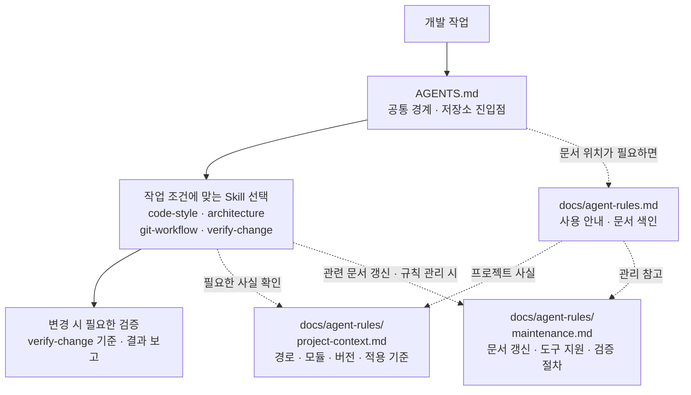

# Agent Rules·Skills 관리 가이드

팀 협업 규칙의 사용 방법과 관련 문서의 위치를 안내합니다.

## 사용 방법과 구조

에이전트에는 저장소 루트의 [AGENTS.md](../AGENTS.md)를 읽게 합니다.
작업에 해당하는 Skill만 추가로 읽으면 됩니다. 세부 규칙은 각 Skill 한 곳에서 관리합니다.

```text
AGENTS.md                              공통 원칙·저장소 지도·작업별 링크
.agents/skills/
├── code-style/SKILL.md                 Swift 스타일
├── architecture/SKILL.md               TCA·모듈·기기별 저장/통신 책임
├── git-workflow/SKILL.md               브랜치·커밋·이슈·PR·리뷰
└── verify-change/
    ├── SKILL.md                        변경별 검증 기준·명령·결과 보고
    └── scripts/check_agent_docs.sh     Bash 문서 형식·로컬 파일 링크 검사
docs/agent-rules.md                     사용 안내·문서 색인
docs/agent-rules/
├── project-context.md                  현재 구현·적용 기준
└── maintenance.md                      문서 갱신·규칙 관리·도구 지원과 검증
```

가까운 협업 절차인 Git·PR은 하나의 Skill에서 관리합니다.
참고자료와 템플릿은 기존 파일·공식 문서 링크를 재사용하며, 필요한 경우에만 `references/`나 `assets/`를 추가합니다.
에이전트를 쓰지 않는 팀원은 기존 Xcode·Git 작업을 그대로 할 수 있습니다.
이 파일들은 hook·자동 실행·패키지 설치·CI 변경을 추가하지 않습니다.

## 문서 역할과 작업 흐름

`AGENTS.md`는 항상 적용할 공통 경계와 저장소 진입점, 작업에 맞는 Skill 선택 안내를 제공합니다.
Skills는 선택한 작업의 상세 규칙과 실행 절차를 담습니다.
docs는 사용 안내·프로젝트 사실·관리 참고자료를 담으며, 세부 작업 규칙은 Skills에서 관리합니다.



실선은 작업과 변경 검증의 흐름이고 점선은 필요할 때만 읽는 참고 경로입니다.
모든 Skill·문서를 순서대로 읽으라는 뜻은 아닙니다. 도구별 자동 탐색은 별도로 확인하며,
관련 문서 갱신은 작업 중 수행하는 절차이지 상시 자동 동기화가 아닙니다.

## 문서 색인

- [현재 구현과 적용 기준](agent-rules/project-context.md): 경로·모듈·버전·팀 확인 사항
- [문서 갱신과 규칙 관리](agent-rules/maintenance.md): 구현 변경에 따른 갱신·규칙 수정
- [에이전트 지원과 검증](agent-rules/maintenance.md#에이전트-지원과-검증): 도구 지원·선택 시나리오·문서 검사

## 팀 규칙의 적용 위치

| 규칙 | 관리 위치 |
| --- | --- |
| 브랜치·커밋·이슈·PR | git-workflow: 이름·제목·본문 구성·변경 분리·다이어그램·리뷰 준비 |
| Git·코드 리뷰 | git-workflow: Git Flow·CodeRabbit·팀원 승인 |
| Swift 스타일 | code-style: 이름·레이아웃·주석의 필요성·로컬 lint 설정 |
| Feature와 모듈 | architecture: View/Feature 역할·하위 Feature 분리 검토·내부 참조 제한·모듈 경계 |
| 비동기 동작 | architecture: Effect 수명·이벤트 순서·입력과 응답·복구 경로; 검증 시나리오는 verify-change |
| 저장과 전송 | architecture: iPhone 저장·Watch 전송·완료 상태·중복 방지 |
| 공통 코드와 디자인 | architecture: 공통화 시점·Lo-fi 단계 범위·UI 책임·패키지 연결 |
| 변경별 검증 | verify-change: 빌드·SwiftLint·동작 검증·검증 수단 추가 범위·현재 PR의 CI 실행 확인·결과 보고 |
| 공통 원칙 | AGENTS.md; 명령·상세 절차는 Skill로 분리 |
