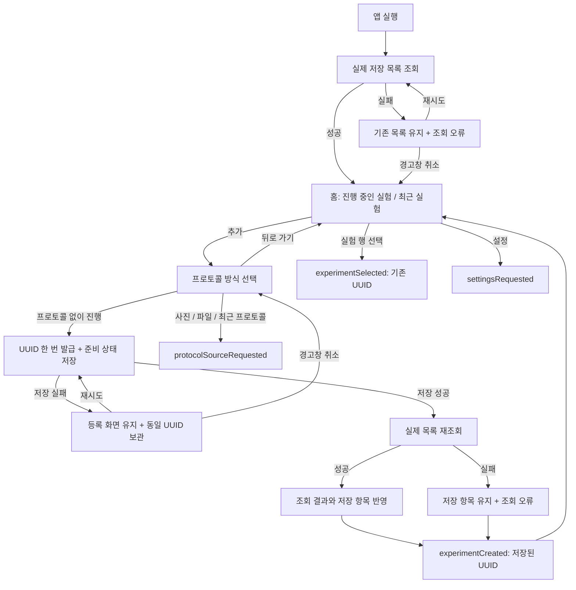
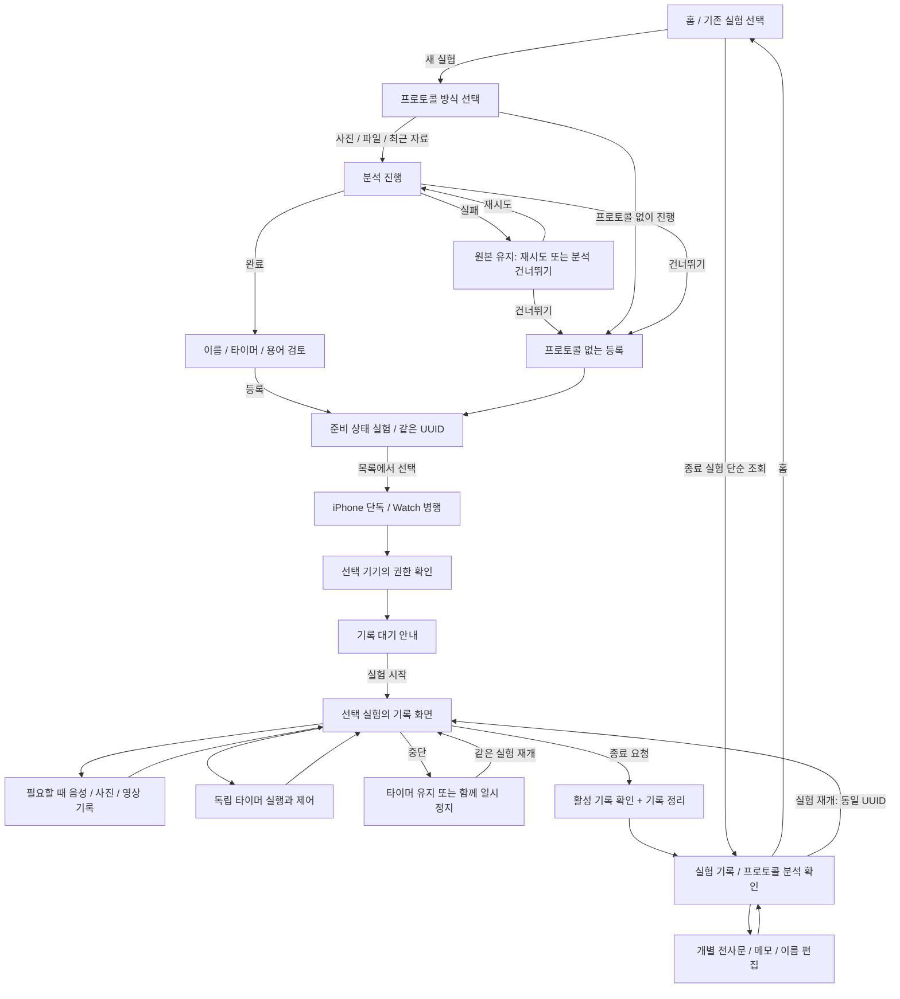
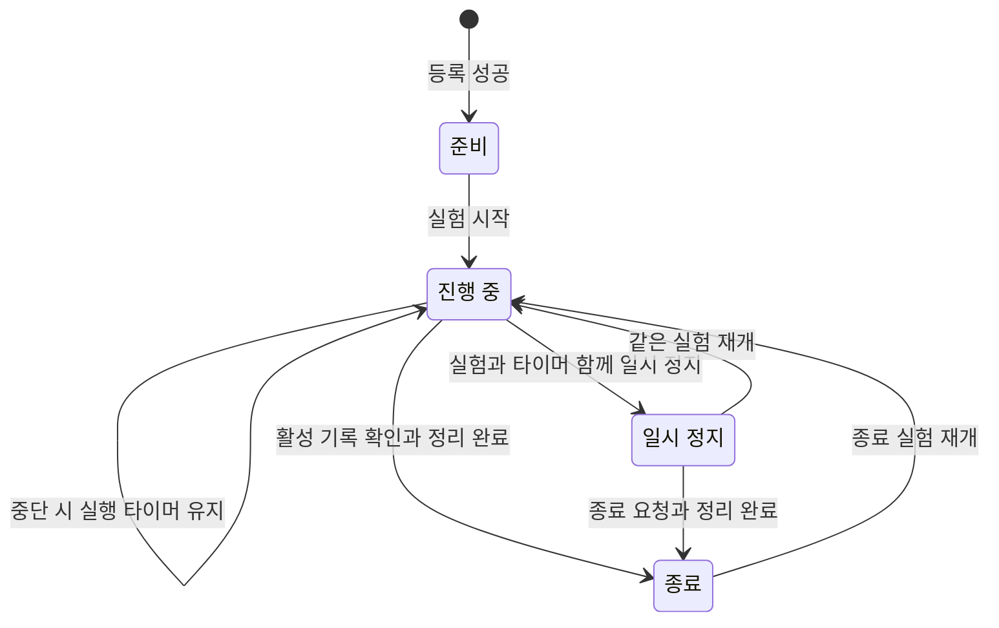
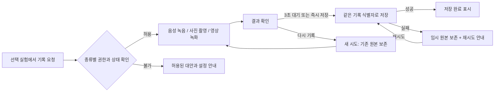
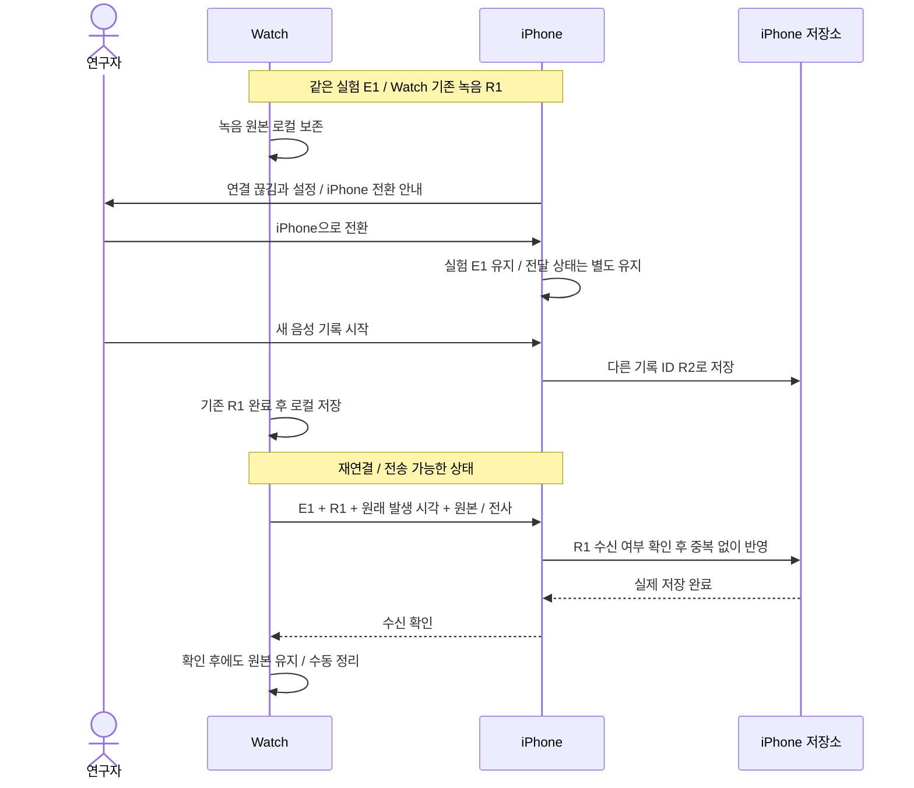

# Labcord 앱 흐름과 연결 계약

확인일: 2026-10-28 KST. 이 문서는 전체 제품의 목표 흐름과 현재 실행 가능한 흐름을
구분한다. 기획에 있는 전환을 구현 완료로 표시하지 않으며, 미정인 동작은 별도 결정사항으로 남긴다.

## 근거와 구현 상태 읽는 법

기획 근거는 [Manyfast 프로젝트](https://manyfast.io/editor/5ece826d-ca56-4e8c-94d3-6dcdb1a301f8?map=prdMap)의
11개 기능, 연결된 13개 스펙과 8개 정책을 항목별로 조회한 내용이다. 메타 문서는
2026-10-19 생성본이므로 탐색용으로만 사용했다. 외부 문서의 `todo` 표시와 실제 코드의
완료 상태는 별개이며, 이 작업에서 외부 기획·디자인 문서를 수정하지 않았다.

코드 기준은 팀 `develop`의 `e31d08b`, 이번 Entry의 동작 변경 `c01f714`, 별도
`feat/#57-Theo`의 `021b0c2`다. 반영 순서와 PR 근거는 [구현 조사](implementation-audit.md)에 있다.
화면 전체를 실제 비교한 Figma는 [홈 `502:12299`](https://www.figma.com/design/v6cxQ2I6zURWYQaG5pnuBL?node-id=502-12299)와
[등록 `502:12563`](https://www.figma.com/design/v6cxQ2I6zURWYQaG5pnuBL?node-id=502-12563) 두 화면이다.
다른 단계의 화면 ID나 1:1 검증 완료 여부는 추정하지 않는다.

| 표시 | 뜻 |
| --- | --- |
| **연결 완료** | 현재 Entry에서 실제 사용자 동작·상태·저장·이벤트가 이어짐 |
| **개별 구현** | View·자료형·통신 등 일부 구현이 있으나 앱의 전체 경로와 연결되지 않음 |
| **feat57 전용** | 별도 세션 브랜치에만 구현되어 현재 Entry/develop에 포함되지 않음 |
| **기획** | 요구사항은 있으나 현재 앱에 실행 경로가 없음 |
| **미정** | 기획 또는 기술 검증에서 결정하지 않은 내용. 임의의 기본 동작을 확정하지 않음 |

## 현재 앱에서 연결된 흐름

실제 앱 루트는 [ResearchersApp](../Researchers/App/ResearchersApp.swift)의
`ExperimentEntryFeature`와 `ExperimentEntryView`다. 초기 목록은 iPhone SwiftData에서 읽는다.

`Selected`·`Source`·`Settings`는 부모에게 전달할 연결 지점이다. **현재 제품 루트는 이 이벤트를
받아 후속 화면을 여는 처리를 아직 하지 않는다.** 실험 생성 후에도 기기 선택이나 기록 화면으로
자동 이동하지 않고 홈으로 돌아온다. 저장 후 조회 실패의 재시도는 목록 조회만 수행한다.

현재 생성값은 이름 `새 실험`, 상태 `.preparing`, 프로토콜 없음, 시작 시각 없음이다.
등록 화면을 열거나 뒤로 가는 동작만으로 실험을 만들지 않는다. 저장 중에는 중복 제출과
뒤로 가기를 차단한다. 저장 실패 경고창의 취소는 경고창만 닫으며, 등록 취소는 뒤로 가기로
처리한다. 뒤로 가면 미저장 UUID와 오류를 비운다.

홈은 진행 중·일시 정지를 첫 그룹, 준비·종료를 최근 그룹에 표시한다. 각 그룹의 순서는
생성일 최신순이고 같은 생성일은 UUID 문자열로 고정한다. 기록 타임라인의 정렬 기준과 다르다.
상세 API·테스트 실행 방법은 [Entry 구현 안내](experiment-entry.md)를 따른다.

## 전체 제품의 목표 흐름

다음 그림은 **기획 흐름**이다. 현재 연결 완료 구간은 위 그림으로 판단하며, 아래 화살표 전체가
제품 앱에 구현되어 있다는 의미가 아니다. 등록·실험 시작·개별 기록 시작은 서로 다른 동작이다.

| 단계 | 기획 근거 | 현재 구현 상태와 경계 |
| --- | --- | --- |
| 홈 목록·등록 진입 | `F-ZAUWYG`, `S-RYHSOU` | **연결 완료**. 후속 화면 이동은 UUID delegate까지 |
| 프로토콜 없는 등록 | `F-MBXOFY`, `S-IMMKYQ`, `PL-FZNOVP` | **연결 완료**. 기본 이름 저장. 실험명 입력·수정은 **기획** |
| 자료 선택·분석·결과 검토 | `F-MBXOFY`, `S-GTQDLO`, `F-ZCVJGZ` | 입력 선택지 **개별 구현**, 실제 picker·분석·편집은 **기획**. 파서 PR은 closed/unmerged |
| 기기 선택·워치 정보 | `F-JDBAGI` | 페어링 View와 모델명·배터리 통신 **개별 구현**. Entry에서 진입하거나 기기 모드를 저장하는 연결 없음 |
| 권한·기록 대기 | `F-JDBAGI`, `PL-VRRDCD` | 대기 안내 View **개별 구현**. 카메라 권한은 **feat57 전용**. 실제 시작 전환은 **기획** |
| 가로·세로 기록 화면 | `F-VDWXOP`, `F-GXNAXI` | 세션 View·커스텀 시트 **개별 구현**. 카메라 프리뷰·전후면 전환·화면 꺼짐 방지는 **feat57 전용** |
| 음성·사진·영상 원본 저장 | `F-VDWXOP`, `S-PTYCQK`, `S-VVMBTG` | **기획**. 프리뷰나 기록 버튼의 존재는 원본 저장 완료를 뜻하지 않음 |
| 다중 타이머 | `F-QVIJTQ`, `S-IJXPEO`, `S-JSZMUF` | 개별 실행·제어 엔진과 UI는 **feat57 전용**. 이번 실험 UUID·영구 이력 연결은 완료되지 않음 |
| 실험 중단·재개·종료 | `S-AJYCZC`, `S-VEBCWJ` | 상태 enum·이력 모델과 제어 버튼 **개별 구현**, 생명주기 전환 로직은 **기획** |
| 기록 조회·수정·삭제 | `F-LHTPSE`, `F-TUELES` | 공유 기록 모델 **개별 구현**, 실제 검토 화면·저장 연결은 **기획** |
| 연결 끊김·원본 전달·복구 | `F-TBDVDC`, `S-ZSKDKT`, `S-JSRIKZ` | 기기 정보 통신 **개별 구현**, 기록 파일·수신 확인·재전송은 **기획** |
| 저장 공간 정리 | `F-EZPQZV` | 설정 delegate 외 **기획** |

별도 디자인시스템 브랜치에 있는 Setup·Run·Review 표시 컴포넌트도 제품 화면의 데이터·저장·
화면 이동 연결과 구분한다. 현재 Entry는 해당 디자인시스템 API를 사용하지 않는다.

## 준비·등록의 세부 명세

기획 근거: `F-MBXOFY`, `F-ZCVJGZ`, `S-IMMKYQ`, `S-GTQDLO`, `PL-YHZEUC`.

| 상태 / 사용자 동작 | 목표 결과와 예외 계약 | 현재 상태 |
| --- | --- | --- |
| 자료 없는 초기 등록 | 일반 다음은 비활성. 별도 프로토콜 없이 진행은 자료 없이 사용 가능 | **연결 완료** |
| 사진·파일 선택 | 사용자가 고른 자료만 읽고 미리보기·파일명·제거 진입점 표시. 선택 취소로 실험을 만들지 않음 | 이벤트 외 **기획** |
| 최근 프로토콜 선택 | 기존 자료를 변조하지 않는 실험별 독립 참조로 재사용 | **기획** |
| 분석 시작 | 선택 자료를 대상으로 진행·완료·실패·중단을 구분 | **기획** |
| 분석 실패 | 원본 참조 유지. 재시도와 분석 없이 등록을 분리 | **기획** |
| 분석 중 뒤로 가기 | 중단 확인. 취소하면 분석 화면 유지, 이탈을 확인하면 분석·등록 흐름 취소 | **기획** |
| 분석 건너뛰기 | 자유 등록으로 진행. 정상 분석 완료나 완료 알림으로 처리하지 않음 | **기획** |
| 결과 확인 | 이름·시간 숏컷·분류별 용어를 제안값으로 보여주고 수정·삭제 허용 | **기획** |
| 등록 확정 | 기본 이름은 새 실험. 공백만 있는 이름은 허용하지 않음. 준비 정보와 같은 실험 UUID 연결 | 기본값 등록만 **연결 완료** |

문서 한 개와 사진 PNG/JPG가 입력 대상이며 정책에는 PDF·XLSX·HWP·DOCX가 열거되어 있다.
현재 Figma/등록 화면의 파일 문구에는 PDF·XLSX·DOCX가 표시된다. **HWP의 실제 입력 노출과
지원 검증은 정합성을 확인해야 하며**, 화면 문구만으로 지원을 보장하지 않는다.
사진 10장·문서 1GB는 디자인 가정/지원 목표이고 실제 허용 상한은 아직 미정이다.

분석이 실제 완료된 경우에만 완료 알림을 시도한다. 알림 권한이 없어도 앱에서 결과를 볼 수
있어야 하며, 취소·중단·건너뛰기는 정상 완료 알림 대상이 아니다. OS 백그라운드 분석과
알림 배달의 보장 범위는 미정이다.

용어는 재료·샘플/분석 대상·실험 용어·단위로 구분한다. 같은 실험의 공백 차이만 있는
중복 표기를 늘리지 않고 삭제한 용어는 이후 힌트에서 제외한다. 진행 중 목록 편집은 다음
음성 기록부터 반영하며 기존 전사문을 자동 재작성하지 않는다. 자동 추출의 정확도와 갱신
시점은 검증이 필요하다. 용어 준비 완료를 전사 정확도 보장으로 표시하지 않는다.

## 기기 선택과 실제 기록 시작

기획 근거: `F-JDBAGI`, `S-RYHSOU`, `PL-VRRDCD`.

1. 준비된 실험을 선택하고 그 UUID를 기록 대상 후보로 유지한다.
2. iPhone 단독 또는 Watch 병행을 선택한다. 앱의 기기 선택은 시스템의 새 Watch 페어링이 아니다.
3. 병행 모드에서는 기기명·사용 가능 상태·확인 가능한 배터리를 표시한다. 조회 중/조회 실패를
   연결 성공이나 배터리 0%로 대체하지 않는다. Watch가 없어도 iPhone 단독으로 진행할 수 있다.
4. 선택한 기록 종류에 필요한 권한을 확인하고 기록 대기 안내로 이동한다.
5. 사용자가 실험 시작을 선택해야 진행 상태와 시작 이력이 생긴다. 이후 개별 녹음·촬영은
   사용자가 각각 시작한다. **등록 완료나 기록 대기는 상시 녹음·녹화가 아니다.**

| 권한 | 기획상 허용 동작 |
| --- | --- |
| 마이크 허용 | 해당 기기의 음성 기록 사용 가능 |
| 마이크 거부 | 음성 기록은 차단. 카메라가 허용되면 사진과 무음 영상 가능 |
| 카메라 거부 | 사진·영상은 차단. 마이크가 허용되면 음성 기록 가능 |
| 필요한 권한 거부 후 해당 동작 선택 | 시스템 설정으로 이동할 수 있는 안내 제공. 다른 허용된 기록 방식 유지 |

현재 [WatchPairingFeature](../Researchers/Features/WatchPairing/WatchPairingFeature.swift)는 기기 정보를
조회하지만 두 진행 버튼은 비어 있다. [WatchAvailabilityClient](../Packages/ResearchersModules/Sources/LabcordiOS/WatchConnectivity/Clients/WatchAvailabilityClient.swift)의
사용 가능 판정은 페어링·Watch 앱 설치 여부이며, 실시간 기록 전송 가능성까지 보장하지 않는다.
[ExperimentSetupView](../Researchers/Features/ExperimentSetup/ExperimentSetupView.swift)의 기존 안내는
계속 기록 중이라는 문구를 포함하지만 시작 액션이 비어 있다. 기획은 기록 대기와 실제 수집을
구분하므로 후속 연결 시 문구도 함께 정리해야 한다. 최종 대기 안내 문구는 미정이다.

## 실험 상태, 중단과 재개

기획 근거: `F-ZAUWYG`, `S-AJYCZC`, `S-VEBCWJ`, `PL-FZNOVP`.
코드의 [ExperimentStatus](../Packages/ResearchersModules/Sources/LabcordShared/Models/ExperimentStatus.swift)는
네 상태를 선언하지만 이번 Entry가 실행하는 전이는 준비 상태 생성뿐이다.

이 그림은 목표 전이이며 현재 런타임에서 모두 실행되지 않는다. 화면 위치·기록 정리 상태·
개별 녹음/촬영 상태·기기 간 전달 상태는 위 enum 하나에 합치지 않는다.

| 동작 | 반드시 유지할 계약 | 남은 결정 |
| --- | --- | --- |
| 진행 화면 이탈·중단 | 실행 타이머가 있으면 유지/함께 일시 정지를 선택. 단순 화면 이탈로 종료·삭제하지 않음 | 실행 타이머가 없을 때의 확인 UI와 처리 순서 |
| 타이머 유지 | 타이머를 계속 실행하고 실험은 진행 중으로 표시 | 백그라운드·재실행 후 복원 |
| 함께 일시 정지 | 실험과 해당 타이머를 멈춤. 개별 정지와 실험 중단으로 인한 정지 원인을 구분 | 진행 중 녹음·영상이 함께 있을 때 중단 UI·처리 순서 |
| 일시 정지 실험 재개 | 같은 UUID·기존 기록 유지. 사용할 기기의 권한 재확인. 정지한 타이머는 사용자가 개별 재개 | 기기 재연결·앱 재실행 후 복원 범위 |
| 다른 실험 시작 | 활성 기록 대상은 한 개. 기존 실험 중단 확인을 취소하면 새 실험을 시작하지 않음 | 동시 요청·일시 정지 실험의 활성 대상 점유 세부 기준 |
| 종료 실험 단순 조회 | 상태를 바꾸거나 새 시작 이력을 만들지 않음 | 상세 화면 진입 UX |
| 종료 실험 재개 | 같은 UUID에 추가 기록. 이전 종료 시각·기록·편집 내용 보존, 타이머 자동 재개 금지 | 재개 확인과 활성 실험 전환의 세부 UX |

## 음성·사진·영상 기록과 저장

기획 근거: `F-VDWXOP`, `F-GXNAXI`, `S-PTYCQK`, `S-VVMBTG`, `PL-TCTQHT`.
**현재 제품에서는 이 전체 저장 흐름이 연결되지 않았다.** feat57의 카메라 프리뷰는
아래 촬영·원본 저장·Watch 수신 확인을 대신하지 않는다.

| 종류 | 시작·종료와 결과 | 실패·경합 계약 |
| --- | --- | --- |
| 음성 | iPhone/Watch에서 명시적으로 시작·종료. 진행 전사와 결과를 구분. 원본·전사문·발생 시각을 같은 실험에 연결 | STT 실패·지연 시 원본 먼저 저장, 전사 재시도/전사 없이 저장. 새 녹음 저장 전 기존 시도를 자동 삭제하지 않음 |
| 사진 | 실제 촬영 기기는 iPhone. Watch는 요청·상태 확인을 보조. iPhone에서 사진 결과 확인 | 자동 저장·즉시 저장이 겹쳐도 한 건만 확정. 저장 전 다시 찍은 시도는 타임라인에 추가하지 않으며 이미 저장한 원본은 유지 |
| 영상 | 사용자가 수동 시작·종료. 현장 음성 기본 포함, 마이크 거부 시 무음 허용. 별도 영상 음성 STT 없음 | 영상 녹화 중 독립 음성 녹음 시작 차단. 파일 생성과 재생 가능한 원본 저장을 구분. 중단·저장 실패 시 원본 보존 |

3초는 **결과 확인 후 저장까지의 대기 시간**이며 녹음·영상 길이 제한이 아니다.
명령 전송·캡처 요청·파일 생성·기기 내 저장·상대 기기 수신 완료를 별개로 표시한다.
저장 실패는 완료 피드백을 내지 않고 임시 원본과 재시도 가능성을 안내한다.
백그라운드·화면 잠금·앱 강제 중단·권한 변경의 기기별 처리와 임시 원본 보존 기간은 미정이다.

## 타이머와 카메라 화면의 관계

기획 근거: `F-QVIJTQ`, `S-IJXPEO`, `S-JSZMUF`, `PL-PZEAWZ`.

- **세팅된 타이머**는 준비된 시간 숏컷이고 **진행 중인 타이머**는 독립 실행이다.
  같은 숏컷을 의도적으로 두 번 누르면 두 실행을 만들지만, 동일 제어 요청의 재전달은 중복 처리하지 않는다.
- 실행마다 설정 시간·경과 시간·정지 구간·종료 이력을 유지한다. 구성을 수정·삭제해도 과거 실행의
  설정값과 이력은 바뀌지 않는다. 개별 실행의 정지가 다른 실행을 멈추지 않는다.
- 진행 중 목록을 먼저 확인할 수 있게 하고 종료 예정 시각순으로 표시한다. 완료 타이머는 제거할 때까지
  완료 상태로 남기며 목록에서 제거해도 과거 실행 이력은 지우지 않는다.
- 확장 카메라에서 타이머가 완료되면 기본/축소 화면으로 돌아온다. 이 화면 전환만으로 진행 중
  영상·음성 또는 다른 기록 시작을 중단하지 않는다. 동시 완료의 이력은 개별 확정하고 화면 복귀는 중복 적용하지 않는다.
- 숏컷 15개·동시 실행 5개는 설계 가정이다. 실제 한도, 시간 입력 방식, 완료 알림, Watch 설정 UI,
  잠금·백그라운드·재실행 정확도는 검증 후 정한다.

현재 개별 타이머 실행 구현은 [#74](https://github.com/DeveloperAcademy-POSTECH/2026-C6-M09-Labcord/pull/74)에
있다. 그 구현을 이번 Entry의 UUID·타이머 이력 저장 및 위 기획 전체의 완료로 간주하지 않는다.

## 종료·기록 검토·편집

기획 근거: `S-VEBCWJ`, `F-LHTPSE`, `S-RHOPBL`, `S-EIVHDT`, `F-TUELES`, `PL-GVEEYE`.

종료 요청에서는 진행 중인 녹음·영상과 타이머·미전달 원본을 확인한다. 활성 미디어 종료를
확인한 뒤 기록 정리 상태를 표시하고, 정리가 끝나면 종료 상태와 iPhone 기록 확인으로 연결한다.
Watch에는 iPhone에서 확인하라는 안내를 제공한다. **종료는 원본 삭제·편집 잠금·별도 승인 확정이 아니다.**
미전달 Watch 원본은 로컬에 보존하고 정리 상태와 별도로 표시한다. 정리 실패를 빈 기록의
정상 완료로 표시하지 않는다. 종료 시 진행 중 타이머를 어떻게 마무리할지는 추가 결정이 필요하다.

| 검토 동작 | 목표 계약 | 현재 상태 |
| --- | --- | --- |
| 기록 탭 | 이름·기간·날짜별 기록과 음성/영상 원본 재생·사진 확인 | 모델 외 **기획** |
| 필터·정렬 | 전체/사진/음성/영상/타이머, 최신순 기본·오래된순 선택. 발생 시각 동일 시 생성 순서 유지 | **기획** |
| 누락·실패 표시 | 기록 없음, 필터 결과 없음, 원본 미전달, 삭제됨, 재생 실패를 구분. 일부 실패로 다른 기록을 숨기지 않음 | **기획** |
| 프로토콜 분석 탭 | 등록에 사용한 타이머·용어 재조회. 탭 전환으로 재분석하거나 기존 전사문을 바꾸지 않음 | **기획** |
| 음성 수정 | 개별 더보기에서 수정/삭제. 원본을 재생하며 전사문 수정·저장 | **기획** |
| 사진·영상 메모 | 개별 기록의 직접 진입점에서 바텀시트 편집·저장. 원본과 발생 시각 유지 | **기획** |
| 편집 취소·삭제 | 미저장 변경이 있으면 손실 확인. 삭제 전 대상 확인. 실패를 완료로 표시하지 않음 | **기획** |
| 홈·재개 | 홈 이동과 실험 재개는 편집 저장과 별개. 종료 실험 재개도 같은 UUID에 기록 추가 | **기획** |

종료 후 사진·영상을 별도로 가져와 추가하는 기능은 현재 기획의 기본 범위에 없다.
별도 전체 편집·기록 확정 버튼이나 잠금을 새 전제로 두지 않는다. 저장된 전사문·메모의
편집은 미디어 원본 변조와 구분한다.

## Watch 연결 끊김과 기록 전달

기획 근거: `F-TBDVDC`, `S-ZSKDKT`, `S-JSRIKZ`, `PL-NLDIGW`.
다음은 **미구현 상태의 전달 계약**이다. 현재 기기 정보용 WatchConnectivity 구현을
원본 파일 전달·중복 방지·수신 확인의 구현으로 해석하지 않는다.

연결 끊김은 실험 종료·기록 삭제가 아니다. 기존 Watch 녹음을 전환만으로 종료·폐기하거나
새로 중복 시작하지 않는다. iPhone 전환은 기존 파일의 전달 완료를 기다리지 않으며, 허용된
기록 방식으로 같은 실험을 이어간다. 전환 후 새 녹음은 Watch의 기존 녹음과 다른 기록 ID다.
실제 OS가 계속 녹음을 허용하는 조건은 기기별 검증이 필요하다.

저장·전달·전환 요청이 겹쳐도 실험 UUID·기록 ID·요청 식별·수신 확인으로 중복 반영을 막는다.
전사문만 도착한 상태는 원본까지 도착한 완료와 다르다. 원래 발생 시각은 수신 시각으로 바꾸지
않고, Watch 원본은 수신 확인 후에도 수동 정리 전까지 유지한다. iPhone에서 촬영한 미디어를
Watch가 원본 보유 기기인 것처럼 다시 보내는 흐름은 없다.

## 데이터·부모 Feature 연결 계약

| 대상 | 유지할 관계와 완료 기준 | 현재 코드 |
| --- | --- | --- |
| 실험 UUID | 등록·기기 선택·세션·타이머·기록·검토·재개에서 동일 실험 식별자 사용 | 등록 저장·재시도·생성/선택 delegate **연결 완료** |
| 준비 정보 | 선택 자료·분석 후보·실제 확정값을 구분하고 실험과 연결 | `ExperimentProtocol` 자료형 외 **기획** |
| 실험 생명주기 | 시작·중단·재개·종료 시각과 이력을 유지. 화면 이탈·전달 상태와 분리 | 모델 선언과 최초 준비 이력 외 **기획** |
| 미디어 기록 | 실험·기록 ID·발생 시각·원본 참조·전사문/메모를 연결 | `ExperimentRecord` 선언 외 **기획** |
| 기기 간 전달 | 로컬 저장·전달·수신 확인을 분리. 재전송은 같은 기록 ID | 기기 정보 통신 외 **기획** |

후속 부모 Feature는 `.experimentCreated(UUID)` 또는 `.experimentSelected(UUID)`를 받은 뒤
**저장된 실험 원본을 같은 저장소에서 조회하는 경계**를 연결해야 한다. 지금 repository/client는
목록 DTO 조회와 생성만 제공하며, 원본 조회 API와 후속 화면의 ModelContainer 환경 주입은 없다.
이 연결을 대신해 새 UUID를 발급하거나 예시 타이머 배열을 실험 데이터로 취급하지 않는다.
실제 저장 책임은 iPhone에 두고, Watch의 원본 로컬 보존·전달 대기는 iPhone 영구 저장 완료와
구분한다. 스키마·메시지 형식의 구체 설계는 아직 이 문서에서 확정하지 않는다.

## 결정이 남은 부분과 검증 기준

| 주제 | 확정된 계약 | 남은 결정·검증 |
| --- | --- | --- |
| 입력·분석 | 선택한 자료만 사용, 실패 시 보존, 건너뛰기 가능 | 실제 형식별 품질·HWP 노출, 장수/용량 상한, 분석 시간·백그라운드·알림 |
| 실행 생명주기 | 활성 기록 대상 한 개, 같은 UUID 재개, 정지 타이머 자동 재개 금지 | 상태 복원, 타이머 없는 중단, 활성 미디어 동반 중단, 종료 시 타이머 처리 |
| 미디어 | 명시적 시작, 결과 확인 3초 후 저장, 원본과 STT 분리 | 기기별 잠금·앱 전환·강제 중단, 파일 크기/길이, 임시 원본 보존 기간 |
| Watch 복구 | 기존 원본 보존, ID 기반 중복 방지, 수신 확인 후에도 수동 정리 | 재전송 횟수·종료 조건, 제스처 요청 식별·매핑, 시계 오차, OS 실행 한계 |
| 편집·정리 | 변경 손실·삭제 확인, 실패 시 기존 내용 유지 | 편집 충돌·완료 기준, 개별 삭제 복구/기기 반영, 실제 삭제 완료 기준 |
| 보안·외부 처리 | 임의 공유·주변 자동 수집 금지, 선택한 앱 내부 데이터만 삭제 | 저장 보호·암호화·분실 대응·외부 처리 동의·법적 보관 기준 |
| UX | 빈 목록도 등록 가능, 대기와 실제 수집 구분 | 온보딩·빈 상태·네트워크 오류·햅틱/소리·최종 안내 문구 |

저장 공간 관리는 `F-EZPQZV`에 따라 실험별 사용량과 명시적으로 재확인한 앱 내부 실험 전체
삭제를 제공하는 기획이다. 미전달 Watch 원본이 있으면 실험 삭제를 차단한다. 자동 휴지통·
자동 삭제·기기 간 동기 삭제는 기본 범위가 아니다. 개별 기록 편집의 삭제·복구 정책과의
구체 정합성은 남은 결정이며 화면 존재를 이유로 임의 확정하지 않는다.

현재 검증은 시뮬레이터에서 Entry의 UUID 단일 생성·저장/조회 오류 분리·동일 UUID 재시도·
취소·재실행 보존·부모 child 제거 및 두 Figma 화면을 대상으로 한다. 테스트 명령과
실행 근거는 [Entry 구현 안내](experiment-entry.md)와 실제 결과 파일을 함께 확인한다.
위 기획의 후속 구현은 중단/재개, STT 실패, 자동/즉시 저장 경합, 연결 끊김/재전송,
종료 정리 실패, 원본 미전달과 삭제 차단을 각각 검증해야 한다. 시뮬레이터에서 입증하지 못한
Watch 런타임·하드웨어·백그라운드 동작은 미검증으로 남기며 성공으로 추정하지 않는다.
