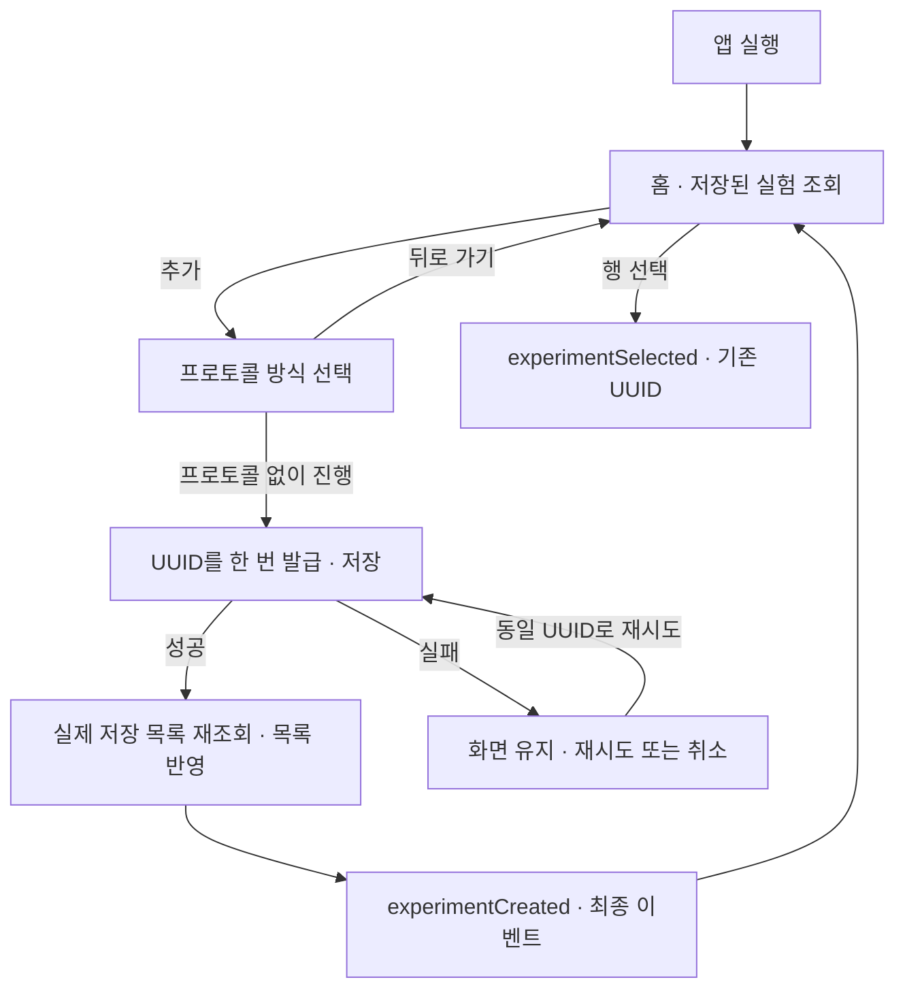
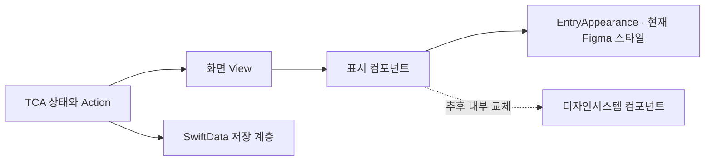

# 홈과 프로토콜 없는 실험 등록

앱 전체 목표 흐름과 단계별 연결 상태는 [앱 흐름 명세](app-flow.md),
기존 구현의 목적과 반영 순서는 [구현 조사](implementation-audit.md)에 있습니다.

## 사용자 흐름

홈의 추가 버튼에서 실험 등록 화면을 열고 **프로토콜 없이 진행**을 선택하면
`새 실험`을 준비 상태로 저장합니다. 저장 성공 후 홈으로 돌아와 최근 실험에 표시합니다.
등록만으로 녹음·촬영·타이머를 시작하지 않습니다.



진행·일시 정지는 진행 중인 실험, 준비·종료는 최근 실험에 표시합니다.
각 그룹은 생성일 최신순이며 동일 시각은 UUID 문자열로 순서를 고정합니다.
목록이 비었을 때도 추가 버튼을 사용할 수 있고, 실제 저장소에 예시 데이터를 넣지 않습니다.

## 구현 책임과 연결 계약

구현은 iPhone 앱의 `Researchers/Features/ExperimentEntry/`에 있습니다.

| 구성 | 책임 |
| --- | --- |
| `ExperimentEntryFeature` | 목록·등록·저장 상태, 중복 요청 차단, 재시도, delegate 이벤트 |
| `ExperimentEntryView` | 화면 이동, 오류 경고창, Feature에 Action 전달 |
| `Presentation/` | Figma 기반 화면·실험 행·배지·입력 방식·버튼 표현 |
| `ExperimentListEntry` | 저장 객체에서 분리한 Sendable 목록 값과 상태 투영 |
| `Persistence/` | iPhone SwiftData 생성·조회와 TCA 의존성 경계 |

하나의 저장소 인스턴스가 ModelContainer를 유지합니다. 각 작업은 별도 ModelContext를 사용하고
자동 저장을 끕니다. `create`는 같은 UUID가 이미 저장됐으면 기존 항목을 반환합니다.
실패한 작업의 context는 다른 화면의 미저장 변경을 rollback하지 않습니다.
저장소 초기화 실패는 다음 조회에서 재시도하며 기존 데이터를 삭제하거나 초기화하지 않습니다.

저장 후 실제 목록을 재조회하고 Feature 목록에 반영한 다음 `experimentCreated`를 보냅니다.
재조회에 실패해도 저장된 항목을 유지하고 목록 조회 오류로 구분합니다. 이때 재시도는 조회만
수행하며 실험을 다시 만들지 않습니다. 성공 delegate 뒤에는 Entry 액션을 보내지 않으므로
부모가 해당 이벤트에서 Entry 상태를 제거하거나 후속 화면으로 전환할 수 있습니다.

기존 공유 `Experiment` 모델을 변경하지 않습니다. 생성값은 `title = "새 실험"`,
`status = .preparing`, `procedure = nil`, `startedAt = nil`입니다.
준비 상태 이력은 기존 생성자가 만듭니다. 실패 후 재시도도 같은 UUID를 사용하며,
저장 중 추가 입력과 뒤로 가기를 막습니다. 취소한 등록은 실험을 만들지 않습니다.

부모 TCA Feature에서 Entry를 조합하고 아래 delegate Action을 처리하면 후속 화면을 연결할 수 있습니다.

| Delegate | 의미 |
| --- | --- |
| `.experimentCreated(UUID)` | SwiftData 저장에 성공한 실험. 이번 흐름에서는 홈 복귀 |
| `.experimentSelected(UUID)` | 홈에서 선택한 기존 실험 |
| `.protocolSourceRequested(ProtocolSource)` | 사진·파일·최근 프로토콜의 실제 입력 연결 지점 |
| `.settingsRequested` | 설정 화면 연결 지점 |

이후 실험 화면을 연결할 때는 전달받은 UUID로 같은 저장소의 실험을 조회해야 합니다.
현재 저장소 API는 목록 값 조회·생성뿐이며, Experiment 원본 조회 API와 후속 화면의
ModelContainer 주입은 아직 연결하지 않았습니다. 기록·타이머를 연결하기 위해 UUID를
새로 만들지 않습니다.
사진·파일 입력, 프로토콜 분석·재사용, 설정 화면과 이후 실험 화면은 이번에 연결하지 않았습니다.
자료를 선택하지 않은 상태의 다음 버튼은 비활성입니다. 화면의 10장·1GB는 디자인 문구이며
입력 지원 상한을 기술적으로 검증했다는 의미가 아닙니다.

## 디자인시스템 교체

원본은 Figma 파일 `v6cxQ2I6zURWYQaG5pnuBL`의 홈 `502:12299`, 등록 `502:12563`입니다.
기존 LabcordDesignSystem API는 사용하지 않습니다.
PR 반영 순서와 기존 화면의 구현 목적은 [구현 조사](implementation-audit.md)에 정리합니다.



교체 지점은 `EntryAppearance`, `EntryText`, `HomeExperimentRow`와 내부 배지,
`EntryRoundButton`, `ProtocolRegistrationView` 내부 입력 항목·다음 버튼입니다.
표시 컴포넌트는 Store와 ModelContext를 참조하지 않고 값과 콜백을 받습니다.
따라서 교체 시 Feature·저장소·UUID 이벤트 계약은 유지할 수 있습니다.
한글 폰트 자원·출처·재현 방법과 베이스라인 근거는 [폰트 매핑 안내](entry-fonts.md)에 있습니다.

## 시뮬레이터 검증

실제 앱 빌드와 SwiftLint는 저장소의 기존 명령을 사용합니다.
아래 호스트는 앱 프로젝트·패키지 설정에 테스트 타깃을 추가하지 않고,
실제 Entry 소스와 `Tests/ExperimentEntry/`를 참조하는 별도 Xcode 프로젝트를 생성합니다.
Python 표준 라이브러리 외에 생성 도구 설치는 필요하지 않습니다.

```sh
python3 scripts/verification/generate-entry-qa.py /tmp/labcord-entry-qa
xcodebuild test \
  -project /tmp/labcord-entry-qa/EntryQA.xcodeproj \
  -scheme EntryQA \
  -destination 'platform=iOS Simulator,name=iPhone 17' \
  -skipMacroValidation \
  -parallel-testing-enabled NO \
  -resultBundlePath /tmp/labcord-entry-results.xcresult \
  CODE_SIGNING_ALLOWED=NO
swiftlint lint --strict
```

결과 경로는 새 경로를 사용합니다. 검증 앱은 별도 bundle ID와 저장소를 사용하며,
초기화 플래그도 검증 앱 자신의 저장소에만 적용됩니다.
검증용 fixture는 메모리 저장소를 사용합니다. 제품 앱에는 검증 플래그나 예시 데이터가 없습니다.

검증 항목은 저장·재조회·최종 이벤트 순서와 부모의 Entry 제거, 재조회 실패 후 조회만 재시도,
저장 실패 후 동일 UUID 재시도, 중복 입력·저장 중 이탈 차단,
오래된 조회 결과 무시, 실제 디스크 재개방, 앱 재실행, 입력 이벤트와 뒤로 가기입니다.
화면 캡처는 iPhone 17의 402×874pt 전체 화면을 두 Figma 화면과 각각 대조합니다.
XCTest 첨부 캡처와 실행 결과를 확인하며, 빌드 성공을 화면 일치나 테스트 통과로 대신하지 않습니다.
