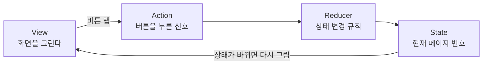

# 온보딩 화면 (#161) 리뷰 자료

대상 파일
- `Researchers/Features/Onboarding/OnboardingFeature.swift`: 상태와 동작 규칙 (TCA Feature)
- `Researchers/Features/Onboarding/OnboardingView.swift`: 화면 그리기

피그마: 온보딩 1~3장 (`2823:37271`, `2823:37281`, `2823:37292`)

---

## 1. 한눈에 보기



- 화면은 **상태를 직접 바꾸지 않습니다.** 버튼을 누르면 Action만 보냅니다.
- Reducer가 Action을 받아 State를 바꿉니다.
- State가 바뀌면 화면이 다시 그려집니다.

---

## 2. Feature 파일 설명

### 구성
| 요소 | 내용 | 이유 |
| --- | --- | --- |
| `enum Page` | `first`, `second`, `third` | 페이지는 3장뿐이라 `Int` 대신 `enum`으로 둠. 4나 -1 같은 잘못된 값이 생기지 않음 |
| `State` | `page` 하나 | 바뀌는 값은 페이지뿐. 제목·설명·이미지는 고정이라 View에 둠 |
| `Action` | `nextTapped`, `previousTapped`, `skipTapped`, `startTapped` | 사용자가 누르는 버튼 4개와 1:1 대응 |
| `body` (Reducer) | 다음·이전은 페이지 이동, 건너뛰기·시작은 상태 변경 없음 | 끝난 뒤 어디로 갈지는 부모 Feature가 정함 |

### 핵심 설계
- **경계 처리**: `Page(rawValue:)`가 `nil`이면 아무 일도 하지 않습니다. 마지막 페이지에서 "다음", 첫 페이지에서 "이전"을 눌러도 안전합니다.
- **Effect 없음**: 네트워크나 저장소를 쓰지 않아서 `@Dependency`나 `.run`이 필요 없습니다.
- **건너뛰기·시작은 부모에게 맡김**: 온보딩이 끝나면 어디로 갈지는 앱 흐름(#175 홈 화면과 함께 결정)에서 정합니다.

---

## 3. View 파일 설명

### 화면 구조 (위에서 아래로)

```
┌────────────────────────────┐
│ (상태바, 안전 영역)           │
│                    건너뛰기  │  ← 1·2장만 보임, 3장은 자리만 유지
│ 제목 두 줄                  │
│ 설명 두 줄                  │
│ ┌────────────────────────┐ │
│ │ 카드 (1·3장)             │ │  ← 남은 높이 전부 사용, 넘치면 잘림
│ │ 또는 사진 (2장 배경)      │ │
│ │                        │ │
│ └────────────────────────┘ │
│           ● ○ ○             │  ← 점 (디자인 시스템 PageControl)
│ 이전        다음 / 시작       │  ← 버튼 줄, 홈 인디케이터 위
└────────────────────────────┘
```

### 코드 구조
| 부분 | 역할 | 이유 |
| --- | --- | --- |
| `VStack` | 위쪽 내용을 위에서 아래로 쌓음 | 간격은 디자인 시스템 토큰(16, 24, 8)으로 줌 |
| `Spacer` (2장) | 2장에서는 카드 자리를 비우고 사진이 보이게 함 | 사진은 배경이라 레이아웃을 밀지 않음 |
| `.background` | 흰 배경(1·3장), 사진 배경(2장) | 배경이 레이아웃 크기를 바꾸지 않게 함 |
| `card` | `Color.clear`로 남은 높이를 차지하고 사진을 채움 | 카드가 커도 아래 버튼을 밀지 않음 |
| `footer` | 점 + 버튼 줄 | 맨 아래에 붙음 (안전 영역 기준) |
| `skipRow` | 3장에서는 `opacity 0` + `disabled` | 숨겨도 높이가 남아서 제목 위치가 세 장 모두 같음 |

### 디자인 시스템 사용
| 쓴 것 | 어디에 |
| --- | --- |
| `IOSButtonStyle` (accent / plain / filled) | 건너뛰기, 이전, 다음·시작 |
| `PageControl` | 점 |
| `Typography.title1Bold`, `Typography.body` | 제목, 설명 |
| `LayoutTokens.spacing8/16/24`, `radiusLg` | 간격, 카드 모서리 |
| `EffectTokens` (medium 그림자) | 카드 그림자 |
| `General/Label/Secondary`, `General/Background/Primary`, `General/Effect/Shadow/Medium/Color` | 색 (앱 타깃에서는 문자열로 접근) |

디자인 시스템에 온보딩 전용 컴포넌트는 없어서, 위 컴포넌트들을 조합했습니다.

### 위치 값
- 위쪽 여백 19: 피그마에서 상태바 아래 건너뛰기까지의 값을 그대로 씀. 나머지 간격은 토큰을 씀.
- 하단 여백: 별도 값 없이 안전 영역(홈 인디케이터)에 맡김. 피그마의 34pt와 같은 효과를 기대하지만, 기기마다 달라질 수 있음.

---

## 4. 확인 결과

| 항목 | 상태 |
| --- | --- |
| Feature 코드 구조 (`@Reducer`, `State`, `Action`, `body`) | 완료 |
| 페이지 이동 경계 처리 | 완료 |
| 디자인 시스템 컴포넌트 사용 | 완료 |
| 빌드 | 미확인 (로컬 환경에 iOS 27 플랫폼 필요) |
| 캔버스 Preview | 미확인 (사용자 캡처로 일부 확인함) |
| 실기기 실행 | 미확인 (앱 시작 흐름에 연결되지 않아 온보딩이 보이지 않음) |

---

## 5. 팀과 함께 정할 것

1. **점 색 (`PageControl`)**: 디자인 시스템 `PageControl`이 Experiment 색 토큰을 써서 흰 배경에서 점이 거의 안 보입니다. 컴포넌트가 색을 받도록 바꿀지, 온보딩에서 직접 그릴지 정해야 합니다. 앞의 방향은 컴포넌트 수정이 맞다고 보고 있습니다.
2. **제목 굵기**: `Typography.title1Bold`가 굵게 나오지 않습니다. 커스텀 폰트에 `.weight(.bold)`를 붙이는 방식이라 적용되지 않는 것으로 보입니다. 굵은 폰트 이름을 따로 정하거나 디자인 시스템을 고쳐야 합니다.
3. **버튼 전체 폭**: 지금은 글자를 가로로 늘리는 방식으로 우회했습니다. 디자인 시스템 버튼에 전체 폭 옵션을 넣을지 정해야 합니다.
4. **1장 사진 효과**: 피그마는 사진을 113%로 키운 뒤 위쪽 기준으로 잘라 보이게 합니다. 지금 구현에는 이 효과가 없습니다.
5. **앱 진입 연결**: Splash 다음에 온보딩을 보여 줄지, 최초 실행 여부를 어디에 저장할지(예: `UserDefaults`, `AppFeature` 상태) 정해야 합니다. #175 최초 홈과 함께 결정합니다.
6. **건너뛰기·시작 후 이동**: 부모 Feature(`AppFeature`)가 `skipTapped`, `startTapped`를 받아 홈으로 보내는 부분을 정해야 합니다.
7. **뒤로 가기·스와이프 차단**: 온보딩이 NavigationStack이나 sheet로 띄워지면 뒤로 가기 제스처로 닫힐 수 있습니다. 진입 방식에 따라 막는 방법을 정해야 합니다.
8. **문구 최종본**: 피그마 문구가 최종본인지 UX Writing 담당(Lawrence)에게 확인이 필요합니다.
9. **색 접근 방식**: 앱 타깃에서는 `Color(.General...)` 심볼을 쓸 수 없어 문자열(`Color("General/...")`)을 씁니다. 이 방식을 팀 규칙으로 볼지 확인이 필요합니다.

---

## 6. 코드 점검 메모

- 사용하지 않는 코드: 없음 (예전에 있던 `cardWidth`, `cardAspectRatio`, `labBackground`, 위치 상수는 현재 파일에 없음)
- 정리하면 좋은 것:
  - `EffectTokens()`를 두 번 만듭니다. 한 번만 만들어도 됩니다.
  - `titleLines`, `bodyLines`, `cardImageName`이 같은 `switch`를 반복합니다. 페이지별 데이터를 한 곳으로 모으면 더 읽기 쉽습니다.
  - 빈 줄이 두 개 들어간 곳이 있습니다 (`footer` 아래).
  - 숫자 `19`에는 의미를 설명하는 주석이 있으면 리뷰에서 설명하기 쉽습니다.

---

## 7. 다음 단계

1. 팀 리뷰에서 5의 항목을 정하기
2. 점 색과 제목 굵기는 디자인 시스템 담당과 함께 처리하기
3. 실기기나 시뮬레이터에서 세 장을 캡처해 피그마와 비교하기
4. 앱 진입 연결은 #175와 함께 진행하기
