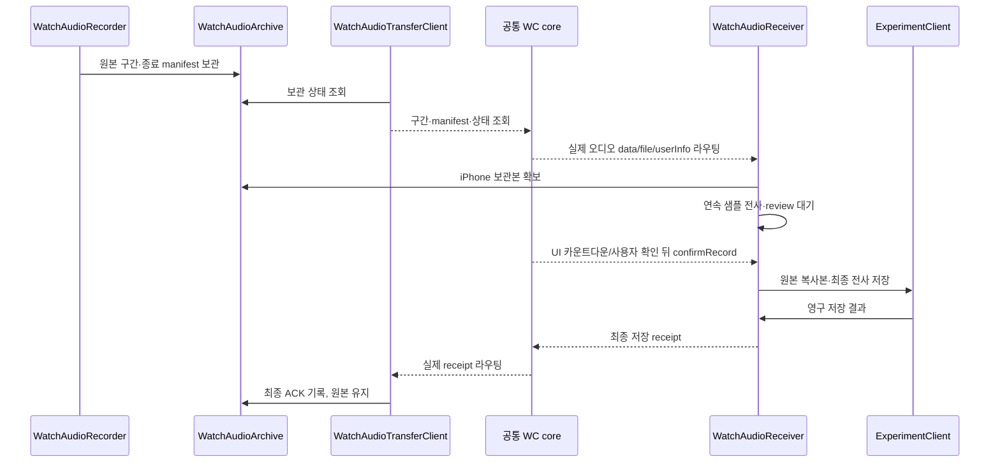

제목: feat/#174: Watch 타이머·미디어 실행과 음성 보관·복구 경로 추가

게시하지 않은 Draft PR 초안이다. #173 core·Watch UI·기록 adapter는 통합했다.
페어링 실기기·Watch 렌더·직접 제스처 연결 검증이 남아 전체 #174 완료·Ready로 전환하지 않는다. 기반 DTO → 캡처/복구 → 실행 연결 순으로
커밋이 분리되어 있으며 최종 PR 분할 시 같은 순서를 유지한다.

## 📄 개요

[#174](https://github.com/DeveloperAcademy-POSTECH/2026-C6-M09-Labcord/issues/174)의
Watch 타이머·사진·영상 명령을 기존 iPhone 기록 흐름에 연결하고, Watch에서 확보한
음성을 연결 끊김·앱 재시작 이후에도 다시 전달할 수 있는 실행 API를 추가합니다.
전송 성공과 iPhone 최종 저장을 구분해 원본이 저장 확인 전에 폐기되지 않도록 합니다.

 

## 🔨 작업 내용

기존 양쪽 WCSession과 앱 수명의 오디오 수신·복구 서비스를 연결했습니다.
큰 상태 묶음 전송이 실패하면 개별 기록으로 보완하고 초기 64개 초과 목록도 전달합니다.
Watch 앱에는 화면 비활성 녹음에 필요한 audio 백그라운드 모드를 선언했습니다.
시작 토큰은 로컬 카운트다운 뒤 실행 직전에 받고, 중단·종료는 진행 중인 iPhone
기록의 실제 저장을 기다립니다. 저장 중 닫기·재촬영은 child reducer에서도 차단합니다.
사진·영상 저장 실패와 취소 결과를 해당 확인 요청과 Watch 기록 상태에 모두 돌려줍니다.
완료 타이머는 원본을 유지하며 사용자가 닫을 때 별도 표시 상태를 저장합니다.

WatchAudioRecorder는 입력을 유한 버퍼로 복사하고 WatchAudioArchive에 원자적으로
보관합니다. 구간 ID·샘플 범위·SHA256·종료 manifest로 누락/중복/역전/충돌을
검증합니다. WatchAudioTransferClient는 상태를 조회하고 누락 구간을 재전송하며,
공통 WCSession의 delegate는 교체하지 않습니다.

WatchAudioReceiver는 확보된 연속 구간만 iPhone Speech 요청에 입력합니다.
전체 구간과 최종 전사를 확보하면 UI에 review 상태를 전달합니다. UI가 소유한
3초 카운트다운의 confirmRecord 이후 기존 saveAudio로 저장하고,
원본·전사 저장 이후에만 savedRecordID를 반환합니다. 원본과 시스템 수신 파일의
보존 복사본은 유지합니다. 사용자 편집이 있는 기존 기록은 갱신하지 않습니다.

타이머·사진·영상은 child Action으로 기존 저장 Effect를 재사용합니다. Watch 사진의
5초 촬영 대기와 UI 소유의 3초 자동 저장을 구분하고, 녹음/영상의 정상 중단 후
저장을 취소·파일 폐기 경로와 분리했습니다. WatchExperimentResponse의 optional
record 필드는 구형 응답의 decode를 유지합니다.

점선은 기기 간 메시지·응답 경로입니다. 기존 WCSession과 실제 수신 서비스를 연결했고,
[통합 API 문서](integration.md)에 책임과 검증 경계를 기록했습니다.
SwiftData migration과 외부 의존성 추가는 없습니다.

AssistiveTouch의 앱 제공 AppShortcut 직접 목록 노출은 공식 문서·SDK·고정 PoC만으로
확인하지 못했습니다. 사용자의 추가 승인에 따라 공식 App Shortcuts 기반 세 전면 Intent와
공통 Runtime을 구현했고 직접 제스처 연결만 실기기 검증으로 남깁니다.
32개 캡처 버퍼·보관 256 MiB·백그라운드 파일 2개 제한은 초기 방어값이며
제품 지연/전력·보존 정책 기준은 실측과 팀 확인이 남아 있습니다.

 

## 🏁 확인 사항

- [x] 코드 컨벤션을 준수했나요?
- [x] 불필요한 로그, 주석, import 등을 삭제했나요?
- [ ] 변경한 기능이 정상적으로 동작하는지 확인했나요?
- [ ] 기존 기능에 영향을 주지 않는지 확인했나요?
- [ ] UI를 구현하거나 변경했다면 구현 화면을 첨부했나요?

소스/순수 계약 검사와 앱 빌드는 확인했으나 실제 기기 동작과 전체 통합 회귀 검증은
미완료입니다. 준비·재개 확인·기록 정리와 모드별 타이머 화면을 Figma 원문과 대조해 보완했으며,
Watch 실행 화면 캡처는 작성자의 남은 검증입니다.
최종 명령·결과·미실행 항목은 [검증 기록](validation.md)에 남깁니다.

 

## 💻 구현 화면

Watch 실행 환경에서 준비·재개 확인·정리·모드별 타이머 화면을 캡처하고 대조하는 작업이 남아 있습니다.
iPhone 실행 확인 화면을 Watch UI 검증 근거로 대신하지 않습니다.

 

## 👀 리뷰 시 중점적으로 봐주셨으면 하는 부분이 있나요?

원본 자동 삭제 정책을 확정하지 않고 최종 ACK 후에도 원본을 보존했습니다.
보존 상한·정리 시점, Speech 장시간 세션/다언어 지원 조건과 Watch 백그라운드 녹음
수명을 제품 기준으로 확정해야 합니다. core의 요청 수명·부모 중단/종료 조율과
저장 ACK는 연결했으며, 실제 기기에서 지연·실패·복구 결과를 확인하는 작업이 남아 있습니다.
